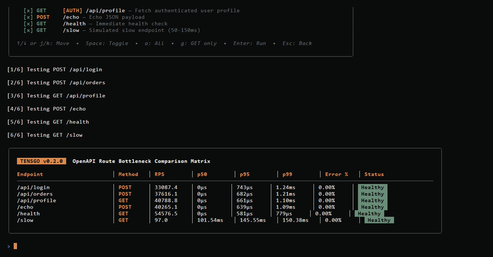

# ⬡ tensgo

**Autonomous API Stress Testing & Bottleneck Discovery Engine** — *by Larch Studios*

[](https://github.com/Errtu0/tensgo/releases)
[](https://go.dev/)
[](https://codecov.io/gh/Errtu0/tensgo)
[](./LICENSE)

**tensgo** is a fast, zero-bloat HTTP load testing CLI and interactive Terminal UI (TUI) written in Go. It combines high-throughput connection-pooled workers, automatic OpenAPI/Swagger route discovery with Auto-Auth, dynamic "What-If" chaos profiles, multi-step YAML user journeys with JSONPath assertions, baseline regression gates, and CI/CD pipeline exporters into a single binary.

<p align="center">
  
</p>

---

## What's New in `v0.3.0` — CI/CD Exporters, Assertions, Baseline Gates & cURL Import

<p align="center">
  
</p>

- **Machine-Readable CI/CD Exporters (`--output-format json,junit,markdown`):** Export versioned JSON (`schema_version: "0.3.0"`), JUnit XML (`<testsuites>` for GitHub Actions, GitLab CI, and Jenkins), and Markdown summaries into `tensgo-reports/` (or `--output-dir` / `--output-file -` for stdout), plus automatic `$GITHUB_STEP_SUMMARY` appending via `--github-summary`.
- **Enhanced YAML `extract` & Declarative `assert`:** Extract variables across steps using dot/bracket JSONPath (`$.data.items[0].id`, `$.items[-1].code`) or response headers (`header:X-Request-Id`), and validate responses with `assert` (`status: [200, 201]`, `json` exact/`!empty`/`contains:`, `headers`, `body_contains`). Failed assertions automatically count toward error-rate quality gates to catch silent HTTP 200 application errors.
- **Baseline Performance Regression Gates (`--baseline`):** Compare live runs against a previous `tensgo-report.json` baseline and fail CI if P95 latency regresses beyond `--max-p95-regression 15%` or throughput drops beyond `--max-rps-drop 20%`.
- **cURL-to-YAML Importer (`tensgo import curl`):** Convert any browser or Postman cURL command (`-X`, `-H`, `-d`, `--data-raw`, `-u` Basic Auth) directly into a runnable `tensgo` YAML scenario.

---

## Benchmarks (`tensgo` vs `hey` vs `k6`)

Measured on **AMD Ryzen 7 7840HS (8C/16T), Windows 11, Go 1.24+**, against a local HTTP/1.1 Keep-Alive target (`127.0.0.1:9090/json`, 10s duration, 5s TCP cooldown between runs). Full reproduction scripts and methodology are available in [`benchmarks/README.md`](./benchmarks/README.md).

| Tool | VUs | Requests | Errors | RPS (req/s) | P50 (ms) | P95 (ms) | P99 (ms) | Peak RSS (MB) | Binary Size (MB) |
| :--- | ---: | ---: | ---: | ---: | ---: | ---: | ---: | ---: | ---: |
| **tensgo** | 50 | 952,040 | 0 (0.00%) | **95,200.5** | **0.51** | **1.69** | **2.87** | **142.1 MB** | **10.81 MB** |
| **hey v0.1.5** | 50 | 957,914 | 0 (0.00%) | 95,786.8 | - | - | - | 206.7 MB | 12.68 MB |
| **k6 v2.4.0** | 50 | 808,506 | 0 (0.00%) | 80,835.4 | 0.53 | 1.76 | 3.07 | 260.5 MB | 65.08 MB |
| **tensgo** | 250 | **1,222,761** | **0 (0.00%)** | **122,201.6** | **1.15** | **6.17** | **9.89** | **192.8 MB** | **10.81 MB** |
| **hey v0.1.5** | 250 | 1,000,008* | 8 (0.00%) | 120,261.5 | - | - | - | 245.3 MB | 12.68 MB |
| **k6 v2.4.0** | 250 | 889,643 | 62 (0.01%) | 88,951.7 | 2.01 | 7.28 | 11.99 | 336.2 MB | 65.08 MB |

> \* `hey` defaults to capping total requests at `1,000,000` unless `-n` is overridden, whereas `tensgo` sustained **1.22M requests** over the full 10-second window with **0 errors**, the lowest latency percentiles, and the smallest memory & binary footprint.

---

## Language & Stack Agnostic

`tensgo` operates purely at the HTTP/REST protocol layer and works seamlessly with any backend stack:
- **Node.js** (Express, Fastify, NestJS)
- **Python** (FastAPI, Django, Flask)
- **Go** (net/http, Gin, Fiber, Echo)
- **Rust** (Axum, Actix-web)
- **Java / Kotlin** (Spring Boot, Quarkus)
- **.NET** (ASP.NET Core)
- **PHP** (Laravel, Symfony)

---

## Core Capabilities

- **Interactive TUI Control Center (`CORE`):** Launch `tensgo` without arguments to open the Larch-themed Bubble Tea menu, configure quick stress tests, inspect live progress, and export HTML reports with a single `[h]` keypress.
- **OpenAPI / Swagger Auto-Discovery + Auto-Auth (`OPENAPI`):** Parse OpenAPI 3.0 or Swagger 2.0 JSON specs from a local file or live URL, auto-generate mock JSON payloads and path parameters, detect protected routes (`[AUTH]`), and automatically sign in via discovered login endpoints to extract Bearer tokens.


*OpenAPI Route Bottleneck Comparison Matrix with status badges (`Healthy`, `Bottleneck`, `Auth Required`, `Not Found`, `Bad Request`).*

- **What-If Chaos Profiles (`CHAOS`):**
  - **Spike Test:** Baseline -> sudden VU surge -> recovery window with **Recovery Time** measurement.
  - **Ramp-Up (Breaking Point):** Gradually scales VUs until `P95 > 1000ms` or `Error Rate > 5%`, pinpointing **Max Healthy Capacity**.
  - **Soak Test:** Sustained load tracking Q1 vs Q4 `P95` **Latency Degradation %**.


*What-If Chaos Spike Report showing Peak P95, Peak Error %, and Recovery Time.*

- **Multi-Step YAML Scenario Flows (`YAML`):** Define stateful user journeys (`Login -> Extract {{token}} -> Protected Calls`) with isolated per-VU variable maps, dot/bracket JSONPath & header extraction, and declarative `assert` checks.
- **Standalone Dark-Mode HTML Reports:** Export zero-dependency Larch-themed HTML reports via `--html <path>` in CLI mode or `[h] Save HTML Report` in TUI mode.
- **CI/CD Quality & Regression Gates:** Enforce `--max-p95`, `--max-error-rate`, `--baseline`, `--max-p95-regression`, and `--max-rps-drop` thresholds with `json`, `junit`, and `markdown` reports.

---

## Quick Start (60 Seconds)

### Install via Package Managers or Go

```bash
# Homebrew (macOS / Linux)
brew install Errtu0/tap/tensgo

# Scoop (Windows)
scoop bucket add errtu0 https://github.com/Errtu0/scoop-bucket
scoop install tensgo

# Go Install
go install github.com/Errtu0/tensgo@latest
```

### Download Pre-Built Binaries

No Go toolchain required — download ready-to-run static binaries for **Linux**, **macOS**, and **Windows (`.exe`)** directly from [GitHub Releases](https://github.com/Errtu0/tensgo/releases).

Or build from source:

```bash
git clone https://github.com/Errtu0/tensgo.git
cd tensgo
go build -o tensgo.exe .   # Windows (or -o tensgo on Linux/macOS)
```

### Run Interactive TUI

```bash
tensgo
```

### Import a cURL Command to YAML

```bash
tensgo import curl --out - 'curl -X POST https://api.example.com/v1/orders -H "Authorization: Bearer token123" -d "{\"item\":\"pro\"}"'
```

### Try the Built-In Local Mock Server & Examples

Start the zero-dependency mock server in one terminal:

```bash
go run ./examples/mock_server.go -addr :8080
```

Then test any of the ready-to-run examples in another terminal:

```bash
# 1. Quick high-RPS health benchmark
tensgo --scenario ./examples/01-quick-health.yaml

# 2. Authenticated multi-step checkout flow
tensgo --scenario ./examples/02-auth-checkout-flow.yaml

# 3. Stateful CRUD with JSONPath & Header Assertions (v0.3.0)
tensgo --scenario ./examples/stateful-crud-assertions.yaml --output-format json,junit,markdown

# 4. OpenAPI 3.0 interactive route picker & bottleneck matrix
tensgo --openapi ./examples/03-openapi-demo.json

# 5. Microservices fanout journey
tensgo --scenario ./examples/04-microservices-fanout.yaml

# 6. Webhook JSON burst latency test
tensgo --scenario ./examples/05-webhook-burst.yaml
```

---

## CLI Flags & CI/CD Quality Gates

| Flag | Default | Description |
| --- | --- | --- |
| `-u` | `""` | Target URL to load test (required in direct CLI mode) |
| `-m` | `GET` | HTTP method (`GET`, `POST`, `PUT`, `PATCH`, `DELETE`) |
| `-H` | `""` | HTTP header in `'Key: Value'` format (repeatable) |
| `-b` | `""` | Request body string |
| `-c` | `10` | Number of concurrent workers |
| `-d` | `10s` | Test duration |
| `-t` | `5s` | Per-request timeout |
| `--openapi` | `""` | OpenAPI/Swagger JSON URL or file path to scan |
| `--token` | `""` | Authorization header value for OpenAPI scan |
| `--scenario` | `""` | Path to YAML scenario file |
| `--html` | `""` | Write standalone dark-mode HTML report to file |
| `--output-format` | `""` | Comma-separated CI report formats: `json,junit,markdown` |
| `--output-file` | `""` | Output path for single format, or `-` for stdout |
| `--output-dir` | `tensgo-reports` | Output folder when `--output-file` is omitted |
| `--github-summary` | `false` | Append Markdown summary to `$GITHUB_STEP_SUMMARY` (auto-detected in CI) |
| `--max-p95` | `0` | CI/CD gate: maximum allowed P95 latency (e.g. `300ms`) |
| `--max-error-rate` | `-1` | CI/CD gate: maximum allowed error rate in `%` (e.g. `1.0`) |
| `--baseline` | `""` | Path to baseline `tensgo-report.json` for regression checks |
| `--max-p95-regression` | `""` | Maximum allowed P95 increase vs baseline (e.g. `15%`) |
| `--max-rps-drop` | `""` | Maximum allowed RPS drop vs baseline (e.g. `20%`) |
| `--no-tui` | `false` | Disable live TUI progress animation (auto-disabled in non-TTY) |
| `-v`, `--version` | `false` | Print `tensgo` version |

### CI/CD Pipeline Example

```bash
tensgo --scenario ./examples/stateful-crud-assertions.yaml \
  --no-tui \
  --max-p95 250ms \
  --max-error-rate 0.5 \
  --baseline ./baseline-report.json \
  --max-p95-regression 15% \
  --output-format json,junit,markdown \
  --github-summary
```

---

## Legal Disclaimer

`tensgo` is intended strictly for authorized performance benchmarking, load testing, and resilience verification of systems you own or have explicit written permission to test. You are solely responsible for ensuring compliance with applicable laws and terms of service. The authors and Larch Studios assume no liability for misuse or damage caused by unauthorized testing.

---

## Contributing & License

Contributions, issues, and feature requests are welcome! Released under the [MIT License](./LICENSE) — terminal demos can be regenerated with `vhs docs/tapes/*.tape` and `vhs docs/demo-v03.tape`.

Questions, feedback, or collaborations? Reach out at [hello@tensgo.dev](mailto:hello@tensgo.dev).
