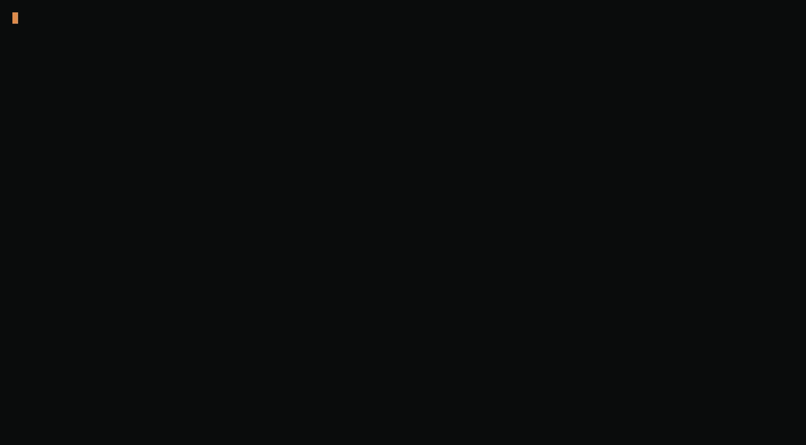
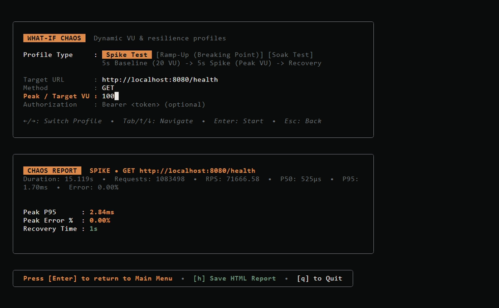

# ⬡ tensgo

**Autonomous API Stress Testing & Bottleneck Discovery Engine** — *by Larch Studios*

[](https://github.com/Errtu0/tensgo/releases)
[](https://go.dev/)
[](./LICENSE)

**tensgo** is a fast, zero-bloat HTTP load testing CLI and interactive Terminal UI (TUI) written in Go. It combines high-throughput connection-pooled workers, automatic OpenAPI/Swagger route discovery with Auto-Auth, dynamic "What-If" chaos profiles, multi-step YAML user journeys, and CI/CD quality gates into a single binary.

<p align="center">
  
</p>

---

## Language & Stack Agnostic

`tensgo` operates purely at the HTTP/REST protocol layer and works seamlessly with any backend stack:
- **Node.js** (Express, Fastify, NestJS)
- **Python** (FastAPI, Django, Flask)
- **Go** (net/http, Gin, Fiber, Echo)
- **Rust** (Axum, Actix-web)
- **Java / Kotlin** (Spring Boot, Quarkus)
- **.NET** (ASP.NET Core)
- **PHP** (Laravel, Symfony)

---

## Core Capabilities

- **Interactive TUI Control Center (`CORE`):** Launch `tensgo` without arguments to open the Larch-themed Bubble Tea menu, configure quick stress tests, inspect live progress, and export HTML reports with a single `[h]` keypress.
- **OpenAPI / Swagger Auto-Discovery + Auto-Auth (`OPENAPI`):** Parse OpenAPI 3.0 or Swagger 2.0 JSON specs from a local file or live URL, auto-generate mock JSON payloads and path parameters, detect protected routes (`[AUTH]`), and automatically sign in via discovered login endpoints to extract Bearer tokens.


*OpenAPI Route Bottleneck Comparison Matrix with status badges (`Healthy`, `Bottleneck`, `Auth Required`, `Not Found`, `Bad Request`).*

- **What-If Chaos Profiles (`CHAOS`):**
  - **Spike Test:** Baseline -> sudden VU surge -> recovery window with **Recovery Time** measurement.
  - **Ramp-Up (Breaking Point):** Gradually scales VUs until `P95 > 1000ms` or `Error Rate > 5%`, pinpointing **Max Healthy Capacity**.
  - **Soak Test:** Sustained load tracking Q1 vs Q4 `P95` **Latency Degradation %**.


*What-If Chaos Spike Report showing Peak P95, Peak Error %, and Recovery Time.*

- **Multi-Step YAML Scenario Flows (`YAML`):** Define stateful user journeys (`Login -> Extract {{token}} -> Protected Calls`) with isolated per-VU variable maps, dot-notation JSONPath extraction, and step-by-step bottleneck tables.
- **Standalone Dark-Mode HTML Reports:** Export zero-dependency Larch-themed HTML reports via `--html <path>` in CLI mode or `[h] Save HTML Report` in TUI mode.
- **CI/CD Quality Gates:** Enforce `--max-p95` and `--max-error-rate` thresholds in non-interactive pipelines (`--no-tui`) with deterministic `PASS`/`FAIL` exit codes (`os.Exit(1)` on violation).

---

## Quick Start (60 Seconds)

### Download Pre-Built Binaries

No Go toolchain required — download ready-to-run static binaries for **Linux**, **macOS**, and **Windows (`.exe`)** directly from [GitHub Releases](https://github.com/Errtu0/tensgo/releases).

### Install via Go

```bash
go install github.com/Errtu0/tensgo@latest
```

Or build from source:

```bash
git clone https://github.com/Errtu0/tensgo.git
cd tensgo
go build -o tensgo.exe .   # Windows (or -o tensgo on Linux/macOS)
```

Cross-platform release binaries can be built with:

```powershell
.\build.ps1
```

### Run Interactive TUI

```bash
tensgo
```

### Try the Built-In Local Mock Server & Examples

Start the zero-dependency mock server in one terminal:

```bash
go run ./examples/mock_server.go -addr :8080
```

Then test any of the 6 ready-to-run examples in another terminal:

```bash
# 1. Quick high-RPS health benchmark
tensgo --scenario ./examples/01-quick-health.yaml

# 2. Authenticated multi-step checkout flow (Login -> Extract Token -> Profile -> Order)
tensgo --scenario ./examples/02-auth-checkout-flow.yaml

# 3. OpenAPI 3.0 interactive route picker & bottleneck matrix
tensgo --openapi ./examples/03-openapi-demo.json

# 4. Microservices fanout journey
tensgo --scenario ./examples/04-microservices-fanout.yaml

# 5. Webhook JSON burst latency test
tensgo --scenario ./examples/05-webhook-burst.yaml

# 6. Generic authenticated workflow template
tensgo --scenario ./examples/tensgo.scenario.yaml
```

---

## CLI Flags & CI/CD Quality Gates

| Flag | Default | Description |
| --- | --- | --- |
| `-u` | `""` | Target URL to load test (required in direct CLI mode) |
| `-m` | `GET` | HTTP method (`GET`, `POST`, `PUT`, `PATCH`, `DELETE`) |
| `-H` | `""` | HTTP header in `'Key: Value'` format (repeatable) |
| `-b` | `""` | Request body string |
| `-c` | `10` | Number of concurrent workers |
| `-d` | `10s` | Test duration |
| `-t` | `5s` | Per-request timeout |
| `--openapi` | `""` | OpenAPI/Swagger JSON URL or file path to scan |
| `--token` | `""` | Authorization header value for OpenAPI scan |
| `--scenario` | `""` | Path to YAML scenario file |
| `--html` | `""` | Write standalone dark-mode HTML report to file |
| `--max-p95` | `0` | CI/CD gate: maximum allowed P95 latency (e.g. `300ms`) |
| `--max-error-rate` | `-1` | CI/CD gate: maximum allowed error rate in `%` (e.g. `1.0`) |
| `--no-tui` | `false` | Disable live TUI progress animation (auto-disabled in non-TTY) |
| `-v`, `--version` | `false` | Print `tensgo` version |

### CI/CD Pipeline Example

```bash
tensgo -u http://localhost:8080/health \
  -c 50 \
  -d 30s \
  --no-tui \
  --max-p95 250ms \
  --max-error-rate 0.5 \
  --html report.html
```

---

## Legal Disclaimer

`tensgo` is intended strictly for authorized performance benchmarking, load testing, and resilience verification of systems you own or have explicit written permission to test. You are solely responsible for ensuring compliance with applicable laws and terms of service. The authors and Larch Studios assume no liability for misuse or damage caused by unauthorized testing.

---

## Contributing & License

Contributions, issues, and feature requests are welcome! Released under the [MIT License](./LICENSE) — terminal demos can be regenerated with `vhs docs/tapes/*.tape`.
